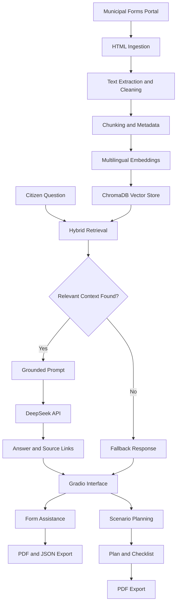
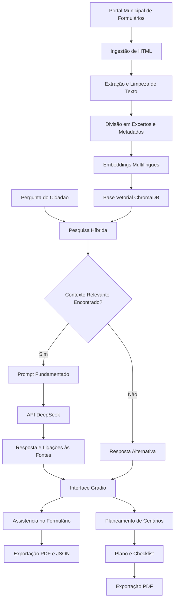

# Balcão Aberto — M.E.L.

**AI-Powered Municipal Information Assistant | Hack4Guimarães**

Making municipal information easier to find, understand, and use.

> **Disclaimer:** Balcão Aberto is a hackathon prototype. It is not an official municipal service of the Municipality of Guimarães and does not replace official guidance.

**Languages:** [🇺🇸 English (US)](#overview) · [🇵🇹 Português (Portugal)](#visão-geral)

## Table of Contents

- [Overview](#overview)
- [The Problem](#the-problem)
- [The Solution](#the-solution)
- [Key Features](#key-features)
- [How It Works](#how-it-works)
- [Architecture](#architecture)
- [Technology Stack](#technology-stack)
- [Data Source](#data-source)
- [Getting Started](#getting-started)
- [Using M.E.L.](#using-mel)
- [Evaluation](#evaluation)
- [Responsible AI, Privacy, and Limitations](#responsible-ai-privacy-and-limitations)
- [Official Municipal Contact](#official-municipal-contact)
- [Future Improvements](#future-improvements)
- [Project Context](#project-context)
- [Português (Portugal)](#português-portugal)

## Overview

**Balcão Aberto** is an experimental project that explores how generative AI and Retrieval-Augmented Generation (RAG) can make municipal information more accessible to citizens in Guimarães, Portugal.

Municipal procedures often require citizens to navigate multiple web pages and documents, interpret administrative terminology, and identify the forms and supporting documents required for a particular request. Balcão Aberto aims to simplify this process through **M.E.L.**, a conversational assistant designed to help citizens find relevant information, understand administrative procedures, and prepare supporting documentation.

The prototype retrieves information from the Municipality of Guimarães’ public online forms portal, generates answers in plain Portuguese, and provides links to relevant source pages whenever available.

The goal is not simply to build a chatbot. It is to explore a more accessible way for citizens to discover information, understand procedures, and prepare for the next step.

## The Problem

Municipal information can be difficult to navigate because:

- Relevant information is distributed across multiple web pages and documents.
- Administrative language can be difficult for citizens to understand.
- Identifying the applicable procedure and required supporting documents can be time-consuming.
- Preparing forms and organizing documentation can be confusing.
- Citizens may not know when the available information is insufficient to answer their questions.

## The Solution

Balcão Aberto provides a conversational interface where citizens can ask questions in natural language and receive answers grounded in retrieved municipal information.

The system combines document ingestion, semantic search, relevance filtering, a large language model, and document-generation capabilities. It also explores voice interaction and scenario-based planning for more complex municipal requests.

When relevant information cannot be retrieved, the assistant is designed to acknowledge the limitation and direct users to the Municipality’s general contact channels rather than deliberately inventing an answer.

## Key Features

| Feature | Description |
|---|---|
| Conversational assistant | Ask questions about municipal procedures using natural language. |
| Retrieval-Augmented Generation (RAG) | Retrieve relevant passages from the indexed municipal document collection before generating an answer. |
| Hybrid retrieval | Combine multilingual semantic search with procedure-title matching and AI-assisted query rewriting. |
| Source references | Display links to the municipal pages used to support an answer. |
| Fallback responses | Provide a predefined response and municipal contact information when relevant context is insufficient. |
| Procedure and attachment assistance | Display supporting documents identified in the retrieved procedure pages, when available. |
| Interactive form assistance | Extract selected information from a conversation to help prefill a municipal request form. |
| PDF generation | Generate a preliminary request document or a structured plan and checklist. |
| JSON export | Export preliminary request information in a structured format for potential future integration. |
| Voice interaction | Support speech-to-text input and text-to-speech output. |
| Complex-scenario planning | Explore a situation, retrieve potentially relevant procedures, and generate an ordered plan with documents, costs, deadlines, sources, and items to confirm. |
| Retrieval evaluation | Run a collection of test questions to assess source retrieval, selected factual answers, and out-of-scope fallback behavior. |

> Feature availability and output quality depend on the indexed documents, model availability, API configuration, and execution environment.

## How It Works

The application follows a RAG-based workflow:

1. **Ingestion** — Retrieve municipal procedure pages from the public online forms portal.
2. **Extraction and cleaning** — Extract relevant HTML text, remove common page boilerplate, and identify PDF links associated with procedure pages.
3. **Chunking** — Split the extracted text into overlapping passages and attach metadata such as the procedure title and source URL.
4. **Embeddings** — Convert passages into multilingual vector representations using a Hugging Face sentence-transformer model.
5. **Vector storage** — Store and search the passages using ChromaDB.
6. **Hybrid retrieval** — Combine semantic similarity with procedure-title matching. If no title matches sufficiently, the system can generate alternative search queries.
7. **Relevance filtering** — Apply a configurable threshold to determine whether retrieved passages should be used.
8. **Answer generation** — Send the question and retrieved context to the configured DeepSeek model.
9. **Source presentation** — Return the answer alongside links to the relevant source pages when available.
10. **Assistance and export** — Use the conversational workflow or scenario planner to help prepare a preliminary request, checklist, PDF, or JSON file.

If no passages meet the relevance threshold, the standard RAG workflow returns a predefined fallback response.

> **Important:** The ingestion pipeline identifies PDF links, but the described implementation does not download and index the contents of those PDFs. The indexed knowledge base is primarily built from extracted HTML text and a general-information document.

## Architecture



## Technology Stack

| Component | Technology |
|---|---|
| Programming language | Python |
| User interface | Gradio |
| Retrieval framework | LangChain |
| Vector database | ChromaDB |
| Embedding model | `sentence-transformers/paraphrase-multilingual-MiniLM-L12-v2` |
| Language model | DeepSeek API, with configured model fallback |
| Retrieval architecture | Retrieval-Augmented Generation (RAG) |
| Hybrid search | Vector similarity, title matching, and query rewriting |
| Web ingestion | Requests and Beautiful Soup |
| Document generation | ReportLab |
| Speech synthesis | gTTS |
| Speech recognition | faster-whisper |
| Structured data export | JSON |
| Development environment | Google Colab / Jupyter-compatible notebook workflow |

## Data Source

The prototype uses publicly available information from the Municipality of Guimarães’ online forms portal:

- [Municipality of Guimarães — Online Services and Forms](https://www.cm-guimaraes.pt)

The notebook discovers procedure links, extracts page content, identifies associated PDF links, and creates a local catalog of the retrieved information.

The number of procedures ingested is configurable. The current notebook configuration sets:

```python
MAX_PROCEDURES = 60
```

This means that at most 60 discovered procedures are processed unless this setting is changed.

The catalog includes source URLs and retrieval dates. These dates record when the information was retrieved; they do not necessarily represent the publication or last-update dates of the original municipal pages.

## Getting Started

### Prerequisites

- Python 3.10 or a compatible Python environment
- Access to a DeepSeek API key
- The project notebook
- Internet access to retrieve municipal pages and call the language-model API
- Sufficient memory and storage for embeddings, the vector database, and optional speech recognition
- The required Python dependencies

> The notebook imports Google Colab’s `userdata` module for secret management. As provided, its setup therefore targets Google Colab. A local Jupyter environment requires an alternative secret-management implementation.

### 1. Obtain the project

Clone the repository:

```bash
git clone https://github.com/devbia-ferna/Hack_RAG.git
cd Hack_RAG
```

Alternatively, open the notebook directly in Google Colab or Jupyter Notebook.

### 2. Install dependencies

The notebook installs its dependencies in separate cells. Its main installation command is:

```bash
%pip install "langchain==0.3.27" \
    "langchain-community==0.3.31" \
    "langchain-chroma==0.2.6" \
    "langchain-core>=0.3.0,<0.4.0" \
    "langchain-huggingface>=0.3,<1" \
    "langchain-google-genai>=2.1,<3" \
    "langchain-openai" \
    sentence-transformers pypdf beautifulsoup4 \
    requests gradio reportlab -qqq
```

The notebook also installs speech-related dependencies:

```bash
%pip install gTTS faster-whisper -qqq
```

Additional upgrades are performed in the notebook. These installation instructions reflect the notebook’s current dependency setup; a reproducible deployment should use a tested and pinned dependency manifest.

### 3. Configure the API key

In Google Colab:

1. Open the notebook’s **Secrets** panel.
2. Create a secret named `DEEPSEEK_API_KEY`.
3. Add your API key and enable notebook access to the secret.
4. Run the setup cell.

The notebook retrieves the secret using:

```python
from google.colab import userdata

DEEPSEEK_API_KEY = userdata.get("DEEPSEEK_API_KEY")

if not DEEPSEEK_API_KEY:
    raise ValueError("Configure DEEPSEEK_API_KEY in Colab Secrets.")

os.environ["DEEPSEEK_API_KEY"] = DEEPSEEK_API_KEY.strip()
```

> **Security:** Never commit API keys, credentials, or other secrets to the repository. For local development, use environment variables or an appropriate secret manager.

### 4. Run the notebook

Execute the notebook cells in order. The workflow:

1. Retrieves the municipal procedure pages.
2. Creates and validates the local service catalog.
3. Generates text chunks and multilingual embeddings.
4. Builds the ChromaDB vector collection.
5. Configures hybrid retrieval and the DeepSeek language model.
6. Defines the RAG assistant, scenario planner, form assistance, and export functions.
7. Launches the Gradio interface.

The first run can take longer because the notebook must retrieve the source pages and download or initialize the embedding and speech-recognition models.

> The notebook recreates the ChromaDB collection when the embedding cell runs. Re-executing that cell replaces the existing collection rather than incrementally updating it.

### 5. Access the interface

The notebook launches the Gradio application with `share=True`, which requests a publicly accessible Gradio sharing link.

Use this link to open the prototype in a browser.

> A sharing link is not a production deployment and should not be treated as a secure or permanent public service. Do not use real citizens’ personal information in the demonstration.

## Using M.E.L.

The interface provides two main workflows.

### Conversational assistant and preliminary request

1. Ask a question about a municipal service.
2. Review the answer and its source links.
3. When available, review the supporting documents identified for the relevant procedure.
4. Provide or correct the information in the preliminary request form.
5. Generate a PDF and a JSON file when the required fields are valid.

The form can attempt to extract selected details from a message, including a name, location, and request description. It also recognizes potential Portuguese tax identification numbers (NIFs) and telephone numbers locally.

> The generated document is a preliminary request only. The application does not automatically submit the request to the Municipality. The user must follow the official submission process.

### Complex-scenario planning

1. Describe a situation, such as opening a café or planning construction work.
2. Let the assistant generate alternative searches for relevant municipal procedures.
3. Review the proposed steps, document checklist, source links, and any indicated costs or deadlines.
4. Identify information that must be confirmed with the Municipality.
5. Export the plan as a PDF.

Costs and deadlines that are not stated in the retrieved context should be labeled as **not indicated**. A generated plan is not a guarantee that every applicable permit or legal obligation has been identified.

### Voice interaction

The prototype supports microphone input using `faster-whisper` for speech recognition and `gTTS` for speech synthesis.

The speech-recognition model is configured to run locally on the CPU. Speech synthesis requires access to the gTTS service. Actual performance depends on the environment, installed tools, and network availability.

## Evaluation

The notebook includes an initial retrieval and response evaluation workflow using a predefined set of test questions.

The cases cover:

- Questions with expected factual information.
- Questions intended to retrieve a particular municipal procedure.
- Out-of-scope questions that should trigger the fallback response.

The evaluation records expected source matches, selected factual indicators, fallback behavior, and technical errors. Results are exported to `avaliacao.csv`.

> This is an initial, rule-based evaluation rather than a comprehensive assessment of answer quality. It does not establish that all answers are correct, all sources are authoritative, or all municipal procedures are covered.

Further evaluation should measure retrieval precision and recall, factual accuracy, source fidelity, appropriate refusal behavior, latency, and performance across representative user questions.

## Responsible AI, Privacy, and Limitations

Balcão Aberto is an experimental prototype. It should not be used as a substitute for official municipal guidance or as the sole basis for administrative or legal decisions.

### Accuracy and source reliability

- Generated responses can contain incorrect or unsupported statements, even when source documents are retrieved.
- Source links help users verify information but do not guarantee that every statement is supported by the cited pages.
- The quality of retrieval depends on document coverage, extraction quality, embeddings, query wording, and the relevance threshold.
- The current collection is limited by the configured ingestion scope and the content available on the municipal portal.
- Changes to the source website are not automatically reflected in an existing vector collection until the ingestion workflow is run again.
- PDF links are detected but their contents are not indexed by the described pipeline.

### Privacy and personal information

The interface is intended for demonstration with fictional data.

The notebook attempts to recognize NIF and telephone numbers locally, without sending those extracted numbers to the language model through that particular extraction step. However, questions and other message content can be sent to the DeepSeek API, and the automatic extraction of names, locations, and request descriptions may also send message text to the model.

Therefore, the prototype should not be described as processing all personal information locally or as guaranteeing that no information leaves the execution environment.

The application code does not implement an end-to-end municipal data-protection framework. Before any real-world deployment, data flows, provider retention policies, access controls, consent and transparency requirements, logging, and applicable GDPR obligations must be assessed.

### Security and deployment

- API credentials must be stored securely.
- Public sharing links should be used only for appropriate demonstration data.
- The prototype has not been established as a production-hardened service.
- Authentication, authorization, rate limiting, monitoring, and other operational safeguards would need to be assessed and implemented for production use.
- Uploaded files are represented by their filenames in the described preliminary request workflow; the code does not implement a complete official document-submission process.

### Administrative limitations

- The assistant does not submit forms to the Municipality.
- Generated PDFs and JSON files are supporting artifacts, not official municipal submissions.
- The application does not establish that a request is legally valid or complete.
- Users should verify requirements, costs, deadlines, and applicable procedures through official municipal channels.

## Official Municipal Contact

For questions that cannot be answered from the available information, the prototype directs users to the Municipality of Guimarães:

| Channel | Contact |
|---|---|
| Telephone | 253 421 200 |
| Email | [geral@cm-guimaraes.pt](mailto:geral@cm-guimaraes.pt) |
| Official website | [cm-guimaraes.pt](https://www.cm-guimaraes.pt) |

> Contact information should be verified before production use.

## Future Improvements

- Expand the indexed collection and incorporate the contents of relevant PDF documents.
- Schedule source updates and track document freshness.
- Improve hybrid retrieval, query rewriting, and relevance calibration.
- Add automated unit, integration, and regression tests.
- Develop a larger, manually verified evaluation dataset.
- Measure source attribution and factual accuracy.
- Improve accessibility, multilingual support, and voice interaction.
- Strengthen privacy, security, and observability.
- Integrate validated links to official municipal procedures.
- Explore secure integrations with municipal systems, subject to authorization and appropriate safeguards.
- Conduct usability testing with citizens and municipal staff.

## Project Context

Developed for **Hack4Guimarães**, Balcão Aberto explores how AI can make municipal information easier to find, understand, and use.

M.E.L. is a prototype of a more accessible way to navigate municipal information: ask a question, understand the available guidance, verify the sources, and prepare for the next step.

**Balcão Aberto — Ask. Understand. Prepare.**

---

# Balcão Aberto — M.E.L.

**Assistente de Informação Municipal com IA | Hack4Guimarães**

Tornar a informação municipal mais fácil de encontrar, compreender e utilizar.

> **Aviso:** O Balcão Aberto é um protótipo desenvolvido para um hackathon. Não é um serviço oficial do Município de Guimarães e não substitui a orientação oficial.

**Idiomas:** [🇵🇹 Português (Portugal)](#visão-geral) · [🇺🇸 English (US)](#overview)

## Índice

- [Visão Geral](#visão-geral)
- [O Problema](#o-problema)
- [A Solução](#a-solução)
- [Funcionalidades Principais](#funcionalidades-principais)
- [Como Funciona](#como-funciona)
- [Arquitetura](#arquitetura)
- [Tecnologias Utilizadas](#tecnologias-utilizadas)
- [Fonte de Dados](#fonte-de-dados)
- [Como Começar](#como-começar)
- [Como Utilizar o M.E.L.](#como-utilizar-o-mel)
- [Avaliação](#avaliação)
- [IA Responsável, Privacidade e Limitações](#ia-responsável-privacidade-e-limitações)
- [Contactos Oficiais do Município](#contactos-oficiais-do-município)
- [Melhorias Futuras](#melhorias-futuras)
- [Contexto do Projeto](#contexto-do-projeto)

## Visão Geral

O **Balcão Aberto** é um projeto experimental que explora como a inteligência artificial generativa e a Geração Aumentada por Recuperação (*Retrieval-Augmented Generation*, RAG) podem facilitar o acesso dos cidadãos à informação municipal em Guimarães, Portugal.

A consulta de procedimentos municipais pode obrigar os cidadãos a percorrer várias páginas e documentos, interpretar linguagem administrativa e identificar os formulários e documentos necessários para cada pedido. O Balcão Aberto procura simplificar este processo através do **M.E.L.**, um assistente conversacional concebido para ajudar os cidadãos a encontrar informação relevante, compreender procedimentos administrativos e preparar documentação de apoio.

O protótipo recupera informação do portal público de formulários da Câmara Municipal de Guimarães, gera respostas em português simples e apresenta ligações às páginas de origem relevantes, sempre que disponíveis.

O objetivo não é apenas criar um chatbot. É explorar uma forma mais acessível de descobrir informação, compreender procedimentos e preparar o passo seguinte.

## O Problema

A informação municipal pode ser difícil de consultar porque:

- A informação relevante está distribuída por várias páginas e documentos.
- A linguagem administrativa pode ser difícil de compreender.
- A identificação do procedimento adequado e dos documentos necessários pode ser demorada.
- O preenchimento de formulários e a organização da documentação podem ser confusos.
- Os cidadãos podem não saber quando a informação disponível é insuficiente para responder às suas dúvidas.

## A Solução

O Balcão Aberto disponibiliza uma interface conversacional na qual os cidadãos podem colocar perguntas em linguagem natural e receber respostas fundamentadas na informação municipal recuperada.

O sistema combina recolha de documentos, pesquisa semântica, filtragem por relevância, um modelo de linguagem de grande dimensão e funcionalidades de geração de documentos. Explora também a interação por voz e o planeamento de cenários para pedidos municipais mais complexos.

Quando não é possível recuperar informação relevante, o assistente está concebido para reconhecer essa limitação e encaminhar o utilizador para os contactos gerais do Município, em vez de inventar deliberadamente uma resposta.

## Funcionalidades Principais

| Funcionalidade | Descrição |
|---|---|
| Assistente conversacional | Colocar perguntas sobre procedimentos municipais em linguagem natural. |
| Geração Aumentada por Recuperação (RAG) | Recuperar excertos relevantes da coleção de documentos municipais indexados antes de gerar uma resposta. |
| Pesquisa híbrida | Combinar pesquisa semântica multilingue, correspondência com títulos de procedimentos e reformulação de pesquisas com recurso a IA. |
| Referências às fontes | Apresentar ligações às páginas municipais utilizadas para fundamentar uma resposta. |
| Respostas alternativas | Apresentar uma mensagem predefinida e os contactos municipais quando o contexto relevante é insuficiente. |
| Apoio sobre procedimentos e anexos | Apresentar os documentos de apoio identificados nas páginas dos procedimentos recuperados, quando disponíveis. |
| Assistência no preenchimento de formulários | Extrair informação selecionada de uma conversa para ajudar a preencher previamente um formulário de pedido municipal. |
| Geração de PDF | Criar um documento preliminar de pedido ou um plano estruturado com checklist. |
| Exportação JSON | Exportar os dados de um pedido preliminar num formato estruturado, para uma possível integração futura. |
| Interação por voz | Permitir entrada por reconhecimento de voz e reprodução de respostas através de síntese de voz. |
| Planeamento de cenários complexos | Explorar uma situação, recuperar procedimentos potencialmente relevantes e gerar um plano ordenado com documentos, custos, prazos, fontes e aspetos a confirmar. |
| Avaliação da recuperação | Executar um conjunto de perguntas de teste para avaliar a recuperação de fontes, determinadas respostas factuais e o comportamento de resposta alternativa fora do âmbito. |

> A disponibilidade das funcionalidades e a qualidade dos resultados dependem dos documentos indexados, da disponibilidade dos modelos, da configuração da API e do ambiente de execução.

## Como Funciona

A aplicação segue um fluxo de trabalho baseado em RAG:

1. **Ingestão** — Consultar páginas de procedimentos do portal municipal de formulários.
2. **Extração e limpeza** — Extrair texto HTML relevante, remover elementos repetitivos das páginas e identificar ligações para PDFs associados aos procedimentos.
3. **Divisão em excertos** — Dividir o texto extraído em blocos sobrepostos e associar metadados, como o título do procedimento e o URL de origem.
4. **Embeddings** — Converter os excertos em representações vetoriais multilingues, utilizando um modelo `sentence-transformer` da Hugging Face.
5. **Armazenamento vetorial** — Guardar e pesquisar os excertos através do ChromaDB.
6. **Recuperação híbrida** — Combinar semelhança semântica com correspondência de títulos de procedimentos. Se nenhum título corresponder suficientemente, o sistema pode gerar pesquisas alternativas.
7. **Filtragem por relevância** — Aplicar um limiar configurável para determinar se os excertos recuperados devem ser utilizados.
8. **Geração da resposta** — Enviar a pergunta e o contexto recuperado para o modelo DeepSeek configurado.
9. **Apresentação das fontes** — Devolver a resposta acompanhada de ligações às páginas relevantes, quando disponíveis.
10. **Assistência e exportação** — Utilizar a conversa ou o planeador de cenários para ajudar a preparar um pedido preliminar, uma checklist, um PDF ou um ficheiro JSON.

Se nenhum excerto atingir o limiar de relevância, o fluxo RAG principal devolve uma mensagem alternativa predefinida.

> **Importante:** O processo de ingestão identifica ligações para PDFs, mas a implementação descrita não descarrega nem indexa o conteúdo desses ficheiros PDF. A base de conhecimento indexada é construída principalmente a partir de texto HTML extraído e de um documento com informação geral.

## Arquitetura



## Tecnologias Utilizadas

| Componente | Tecnologia |
|---|---|
| Linguagem de programação | Python |
| Interface de utilizador | Gradio |
| Framework de recuperação | LangChain |
| Base de dados vetorial | ChromaDB |
| Modelo de embeddings | `sentence-transformers/paraphrase-multilingual-MiniLM-L12-v2` |
| Modelo de linguagem | API DeepSeek, com alternativa de modelo configurada |
| Arquitetura de recuperação | Geração Aumentada por Recuperação (RAG) |
| Pesquisa híbrida | Semelhança vetorial, correspondência de títulos e reformulação de pesquisas |
| Recolha de páginas Web | Requests e Beautiful Soup |
| Geração de documentos | ReportLab |
| Síntese de voz | gTTS |
| Reconhecimento de voz | faster-whisper |
| Exportação de dados estruturados | JSON |
| Ambiente de desenvolvimento | Notebook compatível com Google Colab / Jupyter |

## Fonte de Dados

O protótipo utiliza informação publicamente disponível no portal de formulários da Câmara Municipal de Guimarães:

- [Câmara Municipal de Guimarães — Serviços Online e Formulários](https://www.cm-guimaraes.pt)

O notebook identifica ligações para procedimentos, extrai o conteúdo das páginas, identifica ligações para PDFs associados e cria um catálogo local da informação recolhida.

O número de procedimentos a ingerir é configurável. A configuração atual do notebook define:

```python
MAX_PROCEDURES = 60
```

Isto significa que são processados, no máximo, 60 procedimentos identificados, salvo alteração dessa definição.

O catálogo inclui URLs de origem e datas de recolha. Estas datas registam quando a informação foi recolhida; não correspondem necessariamente à data de publicação ou de última atualização das páginas municipais originais.

## Como Começar

### Pré-requisitos

- Python 3.10 ou um ambiente Python compatível
- Acesso a uma chave de API DeepSeek
- O notebook do projeto
- Acesso à Internet para consultar as páginas municipais e utilizar a API do modelo de linguagem
- Memória e armazenamento suficientes para os embeddings, a base de dados vetorial e o reconhecimento de voz opcional
- As dependências Python necessárias

> O notebook importa o módulo `userdata` do Google Colab para gerir segredos. Na sua forma atual, a configuração destina-se, por isso, ao Google Colab. Um ambiente Jupyter local exige uma implementação alternativa para a gestão de segredos.

### 1. Obter o projeto

Clona o repositório:

```bash
git clone https://github.com/devbia-ferna/Hack_RAG.git
cd Hack_RAG
```

Em alternativa, abre diretamente o notebook no Google Colab ou no Jupyter Notebook.

### 2. Instalar as dependências

O notebook instala as dependências em várias células. O principal comando de instalação é:

```bash
%pip install "langchain==0.3.27" \
    "langchain-community==0.3.31" \
    "langchain-chroma==0.2.6" \
    "langchain-core>=0.3.0,<0.4.0" \
    "langchain-huggingface>=0.3,<1" \
    "langchain-google-genai>=2.1,<3" \
    "langchain-openai" \
    sentence-transformers pypdf beautifulsoup4 \
    requests gradio reportlab -qqq
```

O notebook instala também as dependências relacionadas com voz:

```bash
%pip install gTTS faster-whisper -qqq
```

São efetuadas atualizações adicionais noutras células. Estas instruções refletem a configuração atual das dependências; para uma implementação reproduzível, deverá ser criado um ficheiro de dependências testado e com versões fixadas.

### 3. Configurar a chave da API

No Google Colab:

1. Abre o painel **Secrets**.
2. Cria um segredo com o nome `DEEPSEEK_API_KEY`.
3. Introduz a chave da API e permite o acesso do notebook ao segredo.
4. Executa a célula de configuração.

O notebook obtém o segredo através de:

```python
from google.colab import userdata

DEEPSEEK_API_KEY = userdata.get("DEEPSEEK_API_KEY")

if not DEEPSEEK_API_KEY:
    raise ValueError("Configura DEEPSEEK_API_KEY em Colab Secrets.")

os.environ["DEEPSEEK_API_KEY"] = DEEPSEEK_API_KEY.strip()
```

> **Segurança:** Nunca incluas chaves de API, credenciais ou outros segredos no repositório. Para desenvolvimento local, utiliza variáveis de ambiente ou um gestor de segredos adequado.

### 4. Executar o notebook

Executa as células pela ordem apresentada. O fluxo de trabalho:

1. Recolhe as páginas dos procedimentos municipais.
2. Cria e valida o catálogo local de serviços.
3. Gera os excertos de texto e os embeddings multilingues.
4. Cria a coleção vetorial no ChromaDB.
5. Configura a pesquisa híbrida e o modelo de linguagem DeepSeek.
6. Define o assistente RAG, o planeador de cenários, a assistência de formulários e as funções de exportação.
7. Inicia a interface Gradio.

A primeira execução pode demorar mais tempo, uma vez que é necessário recolher as páginas de origem e descarregar ou inicializar os modelos de embeddings e de reconhecimento de voz.

> A célula dos embeddings recria a coleção ChromaDB quando é executada. Voltar a executar essa célula substitui a coleção existente, em vez de atualizar incrementalmente os dados.

### 5. Aceder à interface

O notebook inicia a aplicação Gradio com `share=True`, solicitando uma ligação de partilha acessível publicamente.

Utiliza essa ligação para abrir o protótipo no navegador.

> Uma ligação de partilha não corresponde a uma implementação de produção e não deve ser considerada um serviço público seguro ou permanente. Não utilizes dados pessoais reais de cidadãos na demonstração.

## Como Utilizar o M.E.L.

A interface disponibiliza dois fluxos de trabalho principais.

### Assistente conversacional e pedido preliminar

1. Coloca uma pergunta sobre um serviço municipal.
2. Consulta a resposta e as ligações às fontes.
3. Quando disponível, verifica os documentos de apoio identificados para o procedimento relevante.
4. Introduz ou corrige a informação no formulário de pedido preliminar.
5. Gera um PDF e um ficheiro JSON quando os campos obrigatórios são válidos.

O formulário pode tentar extrair determinados dados de uma mensagem, incluindo nome, localização e descrição do pedido. Também reconhece localmente potenciais números de identificação fiscal portugueses (NIF) e números de telefone.

> O documento gerado é apenas um pedido preliminar. A aplicação não submete automaticamente o pedido à Câmara Municipal. O utilizador tem de seguir o processo oficial de submissão.

### Planeamento de cenários complexos

1. Descreve uma situação, como abrir um café ou planear obras.
2. Permite que o assistente gere pesquisas alternativas para encontrar procedimentos municipais relevantes.
3. Consulta os passos propostos, a checklist de documentos, as ligações às fontes e os eventuais custos ou prazos indicados.
4. Identifica a informação que deve ser confirmada junto da Câmara Municipal.
5. Exporta o plano em PDF.

Os custos e prazos que não constem do contexto recuperado devem ser identificados como **não indicados**. Um plano gerado não garante que todos os licenciamentos ou requisitos legais aplicáveis tenham sido identificados.

### Interação por voz

O protótipo permite utilizar o microfone através do `faster-whisper` para reconhecimento de voz e do `gTTS` para síntese de voz.

O modelo de reconhecimento de voz está configurado para funcionar localmente no CPU. A síntese de voz requer acesso ao serviço gTTS. O desempenho efetivo depende do ambiente, das ferramentas instaladas e da disponibilidade da rede.

## Avaliação

O notebook inclui um fluxo inicial de avaliação da recuperação e das respostas, baseado num conjunto predefinido de perguntas de teste.

Os casos abrangem:

- Perguntas com informação factual esperada.
- Perguntas destinadas a recuperar um procedimento municipal específico.
- Perguntas fora do âmbito que devem originar uma resposta alternativa.

A avaliação regista correspondências com as fontes esperadas, indicadores factuais selecionados, comportamento de resposta alternativa e erros técnicos. Os resultados são exportados para `avaliacao.csv`.

> Esta avaliação é inicial e baseada em regras, não constituindo uma avaliação abrangente da qualidade das respostas. Não demonstra que todas as respostas estejam corretas, que todas as fontes sejam oficiais ou que todos os procedimentos municipais estejam abrangidos.

Uma avaliação futura deverá medir a precisão e a cobertura da recuperação, a exatidão factual, a fidelidade às fontes, o comportamento adequado perante perguntas sem resposta, a latência e o desempenho em perguntas representativas dos cidadãos.

## IA Responsável, Privacidade e Limitações

O Balcão Aberto é um protótipo experimental. Não deve ser utilizado em substituição da orientação oficial do Município nem como única base para decisões administrativas ou jurídicas.

### Exatidão e fiabilidade das fontes

- As respostas geradas podem conter afirmações incorretas ou sem suporte, mesmo quando são recuperados documentos relevantes.
- As ligações às fontes ajudam a verificar a informação, mas não garantem que todas as afirmações estejam fundamentadas nas páginas citadas.
- A qualidade da recuperação depende da cobertura documental, da qualidade da extração, dos embeddings, da formulação das perguntas e do limiar de relevância.
- A coleção atual está limitada pelo âmbito de recolha configurado e pelo conteúdo disponível no portal municipal.
- As alterações ao site de origem não são automaticamente refletidas numa coleção vetorial existente. É necessário voltar a executar o processo de ingestão.
- As ligações para PDFs são identificadas, mas o conteúdo desses ficheiros não é indexado pelo processo descrito.

### Privacidade e dados pessoais

A interface destina-se a demonstrações com dados fictícios.

O notebook tenta reconhecer localmente os números de NIF e de telefone, sem enviar esses números extraídos ao modelo de linguagem nessa etapa específica de extração. No entanto, as perguntas e outros conteúdos das mensagens podem ser enviados para a API DeepSeek, e a extração automática de nomes, localizações e descrições de pedidos também pode enviar texto das mensagens para o modelo.

Por conseguinte, não se deve afirmar que o protótipo processa todos os dados pessoais localmente ou que garante que nenhuma informação sai do ambiente de execução.

O código da aplicação não implementa um sistema completo de proteção de dados para um serviço municipal. Antes de qualquer utilização real, devem ser avaliados os fluxos de dados, as políticas de conservação dos fornecedores, os controlos de acesso, os requisitos de consentimento e transparência, os registos e as obrigações aplicáveis ao abrigo do RGPD.

### Segurança e implementação

- As credenciais da API devem ser armazenadas de forma segura.
- As ligações públicas de partilha devem ser utilizadas apenas com dados de demonstração adequados.
- O protótipo não foi validado como um serviço preparado para produção.
- A autenticação, a autorização, os limites de utilização, a monitorização e outras medidas operacionais devem ser avaliados e implementados antes de uma utilização em produção.
- Os ficheiros carregados são representados pelos respetivos nomes no fluxo de pedido preliminar descrito; o código não implementa um processo completo de submissão oficial de documentos.

### Limitações administrativas

- O assistente não submete formulários à Câmara Municipal.
- Os PDFs e ficheiros JSON gerados são documentos de apoio, não submissões municipais oficiais.
- A aplicação não garante que um pedido seja juridicamente válido ou esteja completo.
- Os utilizadores devem confirmar os requisitos, custos, prazos e procedimentos aplicáveis através dos canais oficiais do Município.

## Contactos Oficiais do Município

Quando a informação disponível não permite responder a uma questão, o protótipo encaminha os utilizadores para os contactos gerais da Câmara Municipal de Guimarães:

| Canal | Contacto |
|---|---|
| Telefone | 253 421 200 |
| E-mail | [geral@cm-guimaraes.pt](mailto:geral@cm-guimaraes.pt) |
| Site oficial | [cm-guimaraes.pt](https://www.cm-guimaraes.pt) |

> Os contactos devem ser verificados antes de qualquer utilização em produção.

## Melhorias Futuras

- Expandir a coleção indexada e incorporar o conteúdo dos ficheiros PDF relevantes.
- Agendar atualizações das fontes e acompanhar a atualidade dos documentos.
- Melhorar a recuperação híbrida, a reformulação de pesquisas e a calibração da relevância.
- Adicionar testes unitários, de integração e de regressão automatizados.
- Desenvolver um conjunto de avaliação maior e validado manualmente.
- Medir a exatidão factual e a fidelidade das respostas às fontes.
- Melhorar a acessibilidade, o suporte multilingue e a interação por voz.
- Reforçar a privacidade, a segurança e a observabilidade.
- Integrar ligações validadas para os procedimentos municipais oficiais.
- Explorar integrações seguras com sistemas municipais, mediante autorização e salvaguardas adequadas.
- Realizar testes de usabilidade com cidadãos e trabalhadores municipais.

## Contexto do Projeto

Desenvolvido no âmbito do **Hack4Guimarães**, o Balcão Aberto explora como a inteligência artificial pode tornar a informação municipal mais fácil de encontrar, compreender e utilizar.

O M.E.L. é um protótipo de uma forma mais acessível de navegar pela informação municipal: colocar uma pergunta, compreender a orientação disponível, verificar as fontes e preparar o passo seguinte.

**Balcão Aberto — Perguntar. Compreender. Preparar.**